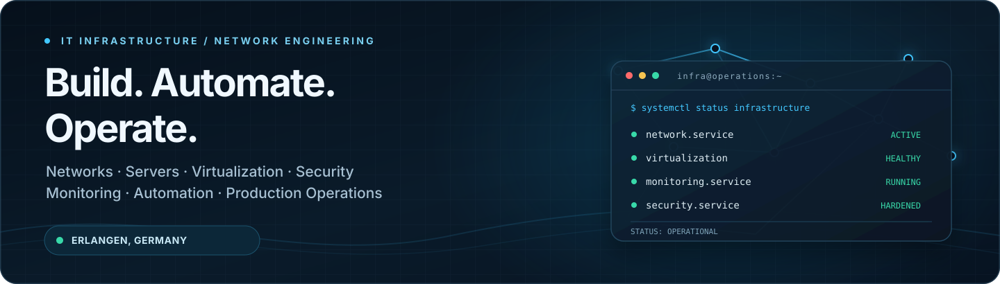

  
  
<strong>System Administration · Network Engineering · IT Infrastructure</strong>

  
Ich plane, betreibe und automatisiere Netzwerke und Serverplattformen — mit Fokus auf zuverlässigen Produktivbetrieb, Virtualisierung, Sicherheit und klare Überwachung.

  

    <a href="https://moli1369.github.io/nachweise/">Portfolio &amp; Network Lab</a>
    &nbsp;·&nbsp;
    <a href="#projects">Ausgewählte Projekte</a>
    &nbsp;·&nbsp;
    <a href="#technology">Technologien</a>
    &nbsp;·&nbsp;
    <a href="mailto:moli1369@gmail.com">E-Mail</a>
  

---

## 01 / Profil

**Infrastruktur muss im Alltag funktionieren.** Mein Schwerpunkt liegt auf dem Zusammenspiel aus Netzwerk, Serverbetrieb, Virtualisierung, Security und Automatisierung. Ich arbeite gerne dort, wo Systeme nicht nur eingerichtet, sondern überwacht, abgesichert und langfristig betrieben werden müssen.

  
  
  
  

## 02 / Arbeitsbereiche

<table>
  <tr>
    <td width="50%" valign="top">
      <h3>🌐 Netzwerk-Engineering</h3>
      
Routing, Switching, LAN/WAN/WLAN, VPN, VLAN und Standortvernetzung — von der Planung bis zur Fehlersuche.

      Cisco · MikroTik · OSPF · MPLS · Fortinet
    </td>
    <td width="50%" valign="top">
      <h3>🖥️ Server &amp; Virtualisierung</h3>
      
Windows- und Linux-Server, Verzeichnisdienste, Migration, Clusterbetrieb, verteilte Speicherung und Hochverfügbarkeit.

      Windows Server · AD/GPO · Linux · Proxmox · VMware · Hyper-V · Ceph
    </td>
  </tr>
  <tr>
    <td width="50%" valign="top">
      <h3>🛡️ Security &amp; Monitoring</h3>
      
Systemhärtung, Incident Response, Firewall-Regeln, Monitoring und nachvollziehbare Betriebszustände.

      FortiGate · PRTG · Zabbix · Grafana · The Dude
    </td>
    <td width="50%" valign="top">
      <h3>⚙️ Automation &amp; Development</h3>
      
Wiederholbare Abläufe, Geräteverwaltung, API-Anbindungen und kleine Werkzeuge, die den Betrieb vereinfachen.

      Python · FastAPI · Django · Flask · C#/.NET · REST APIs
    </td>
  </tr>
</table>

## 03 / Ausgewählte Projekte

<table>
  <tr>
    <td width="50%" valign="top">
      <h3>01 · 180 km Microwave Backhaul</h3>
      
Aufbau und Betrieb einer weitreichenden Richtfunk- und Backhaul-Verbindung mit Routing, Standortanbindung und Monitoring.

      Microwave · WAN · Routing · Monitoring
    </td>
    <td width="50%" valign="top">
      <h3>02 · Automatisierte Incident Response</h3>
      
Python-Workflow zur Bereinigung und Härtung von rund 300 Netzwerkgeräten — von mehreren Wochen manueller Arbeit auf unter eine Stunde reduziert.

      Python · SSH · Automation · Hardening
    </td>
  </tr>
  <tr>
    <td width="50%" valign="top">
      <h3>03 · Proxmox · Ceph · High Availability</h3>
      
Clusterbetrieb mit verteilter Speicherung, Quorum-Betrachtung und Failover für stabile virtuelle Workloads.

      Proxmox VE · Ceph · HA · Virtualisierung
    </td>
    <td width="50%" valign="top">
      <h3>04 · Multi-Site VoIP</h3>
      
Virtualisierte Issabel-PBX-Umgebung zur Verbindung von Büro- und Hafenstandorten, einschließlich getrennter Betriebsnetze.

      Issabel · SIP · VoIP · WAN
    </td>
  </tr>
  <tr>
    <td width="50%" valign="top">
      <h3>05 · Industrial IT</h3>
      
Virtualisierung und Härtung von SIMATIC-/WinCC-Umgebungen für industrielle Umschlagfahrzeuge.

      SIMATIC · WinCC · Windows · Virtualisierung
    </td>
    <td width="50%" valign="top">
      <h3>06 · Rural Connectivity</h3>
      
Vernetzung mehrerer entfernter Standorte über Wireless Backhaul und strukturierte WAN-Anbindung.

      Wireless · Routing · VLAN · WAN
    </td>
  </tr>
</table>

## 04 / Technology

  

  
  
  
  
  
  
  
  
  

## 05 / Portfolio &amp; Code

- **[Portfolio &amp; interaktives Network Operations Lab](https://moli1369.github.io/nachweise/)** — Projektbeispiele, Infrastruktur-Szenarien und technische Arbeitsproben.
- **[MikroTik API](https://github.com/moli1369/api-mikrotik)** — API- und Automatisierungsarbeiten für RouterOS.
- **[Monitoring](https://github.com/moli1369/Monitoring)** — Monitoring- und Betriebswerkzeuge.
- **[MikroTik DHCP Auto Queue](https://github.com/moli1369/mikrotik-dhcp-auto-queue)** — Automatisierung von DHCP-bezogenen Queues.

  
<strong>English overview</strong>

  I build and operate network and server infrastructure with a practical focus on reliability, virtualization, security, monitoring and automation.

  **Core areas:** Cisco and MikroTik networking, OSPF/MPLS/VLAN/VPN, Windows Server and Active Directory, Linux, Proxmox/Ceph/HA, VMware, Hyper-V, Fortinet, PRTG, Zabbix, Grafana and Python-based automation.

  **Selected work:** a 180 km microwave backhaul, Python-based remediation of around 300 network devices, Proxmox/Ceph high availability, multi-site VoIP and virtualized industrial SIMATIC/WinCC systems.

  See the [portfolio and interactive Network Lab](https://moli1369.github.io/nachweise/) for more project details.

---

## 06 / Kontakt

  <h3>Eine technische Frage oder ein passendes Projekt?</h3>
  
Der direkte Kontakt läuft per E-Mail.

  
    
  

