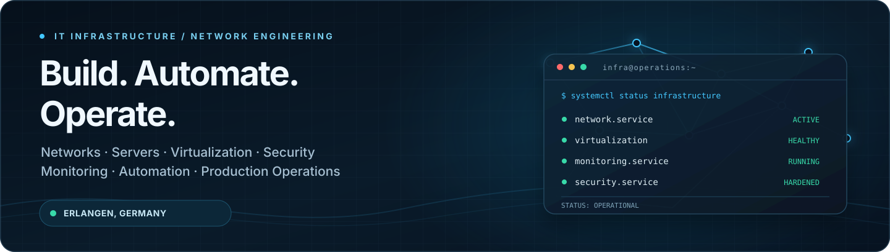

  

  

  
  
  
  

<table align="center">
<tr>
<td align="center">

### 🟢 Open to work · Sofort verfügbar

**Rollen:** Systemadministrator · Netzwerkadministrator · IT-Infrastruktur  
**Ort:** Erlangen · Remote · bundesweit umzugsbereit  
**Status:** Aufenthaltstitel gültig · uneingeschränkte Arbeitserlaubnis (seit Jan 2026)  
**Vertrag:** Vollzeit · unbefristet bevorzugt

  
  
  

  
  
  
  

</td>
</tr>
</table>

  
  
  
  

---

### Featured projects

| Project | Description |
|:--------|:------------|
| **[nachweise](https://github.com/moli1369/nachweise)** | Portfolio · Nachweise · [Live site](https://moli1369.github.io/nachweise/) |
| **[api-mikrotik](https://github.com/moli1369/api-mikrotik)** | MikroTik API automation (Python) |
| **[mikrotik-dhcp-auto-queue](https://github.com/moli1369/mikrotik-dhcp-auto-queue)** | DHCP + automatic queues |
| **[Monitoring](https://github.com/moli1369/Monitoring)** | Monitoring stack & automation |

---

## Deutsch

### Über mich

Ich plane, betreibe und absichere **Netzwerk- und Serverinfrastrukturen** — in ISP-, Unternehmens- und Industrieumgebungen.

**Schwerpunkte:** Virtualisierung · Windows Server / Active Directory · Linux · Routing (OSPF, MPLS) · Monitoring · Python-Automation

> Seit Januar 2026 in Deutschland mit gültigem Aufenthaltstitel und uneingeschränkter Arbeitserlaubnis. Kurzfristig verfügbar · bundesweit umzugsbereit.

### Wonach ich suche

- **Systemadministration** (Windows Server, Active Directory, Linux)
- **Netzwerk** (Routing, Firewall, MikroTik, Cisco, Monitoring)
- **Virtualisierung & Infrastruktur** (Proxmox, VMware, Hyper-V, P2V)
- Automation mit Python wo sinnvoll

### Ausgewählte Projekte

<table>
<tr>
<td width="50%" valign="top">

**180 km Richtfunk**  
Qeshm ↔ Bandar Abbas über die Straße von Hormus  
`5,8 GHz` · Point-to-Point · Dauerüberwachung

</td>
<td width="50%" valign="top">

**~300 Geräte bereinigt**  
Incident Response mit Python-Automation  
`unter 1 Stunde` statt ~3 Wochen manueller Arbeit

</td>
</tr>
<tr>
<td width="50%" valign="top">

**P2V Migration live**  
Produktivsysteme ohne Neuinstallation  
`Proxmox` · `ESXi` · `Hyper-V`

</td>
<td width="50%" valign="top">

**SIMATIC / WinCC**  
Steuerungen für 80-t-Fahrzeuge virtualisiert  
Industrie-IT auf Mini-PCs in Betrieb

</td>
</tr>
</table>

### Sprachen

  
  
  

  
  
  

---

## English

### About me

I design, operate and secure **network and server infrastructure** — in ISP, enterprise and industrial environments.

**Focus areas:** Virtualization · Windows Server / Active Directory · Linux · Routing (OSPF, MPLS) · Monitoring · Python automation

> In Germany since January 2026 with a valid residence title and unrestricted work permit. Available at short notice · willing to relocate nationwide.

### What I am looking for

- **System administration** (Windows Server, Active Directory, Linux)
- **Networking** (routing, firewall, MikroTik, Cisco, monitoring)
- **Virtualization & infrastructure** (Proxmox, VMware, Hyper-V, P2V)
- Practical Python automation

### Selected projects

<table>
<tr>
<td width="50%" valign="top">

**180 km microwave link**  
Qeshm ↔ Bandar Abbas across the Strait of Hormuz  
`5.8 GHz` · Point-to-Point · continuous monitoring

</td>
<td width="50%" valign="top">

**~300 devices remediated**  
Incident response with Python automation  
`under 1 hour` instead of ~3 weeks of manual work

</td>
</tr>
<tr>
<td width="50%" valign="top">

**Live P2V migration**  
Production systems without reinstall  
`Proxmox` · `ESXi` · `Hyper-V`

</td>
<td width="50%" valign="top">

**SIMATIC / WinCC**  
Controllers for 80-t vehicles virtualized  
Industrial IT running on mini-PCs

</td>
</tr>
</table>

### Languages

  
  
  

  
  
  

---

### Tech Stack

  

  
  
  
  
  
  

---

### GitHub Stats

  
  

  

  

---

  
  
  
  
  

  

